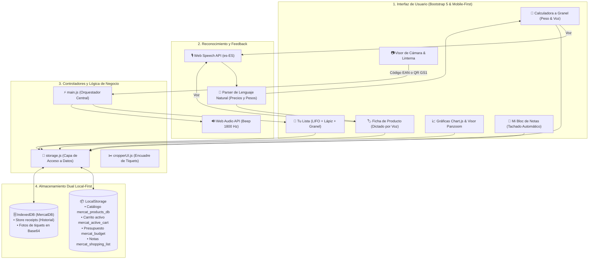

# 🛒 Mercat App — Asistente Inteligente de Compras & Escáner PWA

<div align="center">


[](https://vitejs.dev/)
[](https://getbootstrap.com/)
[](https://www.chartjs.org/)
[](https://developer.mozilla.org/es/docs/Web/API/IndexedDB_API)
[](https://developer.mozilla.org/es/docs/Web/API/Web_Speech_API)
[](LICENSE)

**Tu terminal inteligente y autónomo para el supermercado: escaneo ultrarrápido de códigos de barras, calculadora de productos a granel por peso con dictado por voz, control presupuestario en tiempo real, análisis interactivo de gastos y copias de seguridad totales con fotos.**

[Demo en Vivo (GitHub Pages)](https://huligan111.github.io/mercat/) • [Características](#-características-destacadas) • [Instalación Local](#-puesta-en-marcha-en-local) • [Guía de Uso](#-guía-de-uso-rápido)

</div>

---

## 📖 Índice

1. [El Problema y la Solución](#-el-problema-y-la-solución)
2. [Características Destacadas](#-características-destacadas)
3. [Arquitectura del Sistema](#-arquitectura-del-sistema)
4. [Ingeniería Óptica y Escaneo Inteligente](#-ingeniería-óptica-y-escaneo-inteligente)
5. [Calculadora de Granel y Balanza (Peso)](#-calculadora-de-granel-y-balanza-peso)
6. [Motor de Reconocimiento y Dictado por Voz](#-motor-de-reconocimiento-y-dictado-por-voz)
7. [Análisis Financiero, Gráficas y Visor con Zoom](#-análisis-financiero-gráficas-y-visor-con-zoom)
8. [Filosofía Local-First y Copias Totales con Fotos](#-filosofía-local-first-y-copias-totales-con-fotos)
9. [Estructura del Proyecto](#-estructura-del-proyecto)
10. [Puesta en Marcha en Local](#-puesta-en-marcha-en-local)
11. [Despliegue en GitHub Pages](#-despliegue-en-github-pages)

---

## 🎯 El Problema y la Solución

### El Dilema en el Pasillo del Supermercado
Al hacer la compra semanal, el consumidor suele enfrentarse a frustraciones comunes:
- **Pérdida de control del gasto:** No sabes cuánto dinero llevas acumulado hasta que la cajera pasa el último artículo por la cinta, provocando sorpresas desagradables al pagar.
- **El agujero negro de los productos a granel:** Las frutas, verduras, pan o legumbres al peso no tienen código de barras en el estante; no sabes cuánto sumará la bolsa hasta llegar a caja.
- **Precios que cambian continuamente:** Diferencias entre el precio del lineal y el de caja o subidas inadvertidas de una semana a otra.
- **Pérdida de tiquets físicos:** El papel térmico se borra con el tiempo, impidiendo reclamaciones o revisiones contables familiares.
- **Dependencia de servidores y pérdida de privacidad:** Muchas apps exigen registros obligatorios o fallan cuando no hay buena cobertura dentro del supermercado.

### La Solución: Mercat App
**Mercat App** convierte tu propio smartphone en un terminal autónomo de autoservicio:
- 📱 **100% Funcional sin Internet (PWA Offline-First):** Funciona al instante en el navegador web o como app nativa instalada en tu pantalla de inicio, con orientación vertical fija (*portrait lock*).
- ⚡ **Escaneo Automático en Sub-100 ms:** Apunta la cámara al producto; el nombre y precio se incorporan al carrito instantáneamente.
- 🧺 **Calculadora de Granel Inteligente:** Pesa tu bolsa en la báscula, mete el precio/kg y peso (o díctalo por voz), y súmalo con precisión milimétrica al presupuesto.
- 🎙️ **Dictado por Voz Natural:** Rellena nombres, precios y pesos hablando directamente al móvil sin teclear con las manos ocupadas.
- 📈 **Control de Presupuesto y Gráficas:** Visualiza tu gasto diario, mensual o de cualquier mes concreto con comparativas claras.
- 💾 **Blindaje de Datos con Fotos:** Exporta e importa copias completas con catálogo, notas, tiquets y fotografías en Base64 sin depender de servidores ajenos.

---

## ✨ Características Destacadas

| Área | Funcionalidad | Descripción Técnica |
| :--- | :--- | :--- |
| **PWA Mobile-First** | Instalable & Offline | Manifiesto PWA, Service Worker vía `vite-plugin-pwa`, orientación fija vertical (`screen.orientation.lock('portrait')`) y estilo responsive Bootstrap 5. |
| **Escáner Óptico** | Lector Inteligente de Cámara | Motor `html5-qrcode` con autoarranque, linterna/flash, selector frontal/trasera, lectura desde imagen de galería y pausa anti-duplicados. |
| **Frescos GS1** | QR Dinámico de Peso Variable | Decodificación al vuelo de URLs GS1 Digital Link (ej. carnicería Mercadona), extrayendo GTIN e inyectando el importe exacto de báscula (`3922`). |
| **Cesta Dinámica** | Carrito LIFO & Edición Rápida | Orden LIFO (el último producto añadido aparece arriba). Botón de lápiz integrado en cada fila para cambiar precio o nombre al vuelo. |
| **Presupuesto** | Cúpula con Semáforo Visual | Fijación de tope máximo de gasto (Cerdito 🐷); feedback visual en rojo pulsante al cruzar el límite. |
| **Granel / Balanza** | Calculadora de Peso y Precio | Soporte de unidades (kg / g), fórmula en vivo `peso × precio/kg` y adición al carrito con formato limpio `(1.3 kg × 1.99 €/kg)`. |
| **Voz en Granel** | Dictado de Precio y Peso | Reconocimiento por voz con procesador lingüístico en español para pesos (*"kilo trescientos"*, *"mil trescientos gramos"*, *"un kilo y medio"*) y precios (*"uno con noventa y nueve"*). |
| **Voz en Catálogo** | Dictado en Nuevo Producto | Micrófonos en los campos de *Nombre* y *Precio Unitario* de la ficha de producto para alta ultrarrápida. |
| **Bloc de Notas** | Lista de Compra Inteligente | Notas de compra con tachado automático (*auto-strikethrough*) al escanear los productos en tienda y dictado por voz por comandos. |
| **Análisis Gráfico** | Chart.js Mensual, Diario & Por Mes | Gráfica de barras interactiva con etiquetas de importe superior, alternador de año en curso, mes actual o **selector de cualquier mes específico**. |
| **Tiquets Reales** | Escáner y Visor Panzoom | Encuadre y recorte manual de tiquets con `Cropper.js` y visor con zoom táctil hasta 5x mediante `panzoom`. |
| **Almacenamiento** | Arquitectura Dual Local-First | `LocalStorage` para lectura síncrona en milisegundos + **`IndexedDB` (`MercatDB`)** para almacenamiento masivo de imágenes comprimidas. |
| **Copia de Seguridad** | Respaldo Total Portable | Exportación e importación en formato JSON universal con inclusión completa de las fotografías de tiquets en Base64. |

---

## 🏛 Arquitectura del Sistema

Mercat App adopta una arquitectura modular desacoplada basada en componentes web puros (Vanilla JS ESModules) y persistencia dual en el cliente:



---

## 📷 Ingeniería Óptica y Escaneo Inteligente

### 1. Escáner de Cámara Trasera con Autoarranque
Al abrir la aplicación, el stream de vídeo de la cámara trasera se inicializa de forma inmediata y sin requerir interacción manual.
- **Pausa Inteligente:** Tras cada detección válida, el lector se suspende brevemente para evitar capturas accidentales múltiples de un mismo producto.
- **Controles de Iluminación:** Activa la linterna (*Flash*) con un toque cuando te encuentres en lineales poco iluminados (en dispositivos Android compatibles).
- **Lectura desde Galería:** ¿Tienes una foto del código? Súbela directamente con el botón *Imagen* sin usar la cámara en directo.

### 2. Detección Nativa de QR GS1 Digital Link
En secciones de frescos (carnicería, pescadería o quesería al corte), los supermercados emplean códigos QR dinámicos conformes al estándar **GS1 Digital Link**:
```text
https://qrtrack.mercadona.es/01/08436581961300/21...&3922=00415
```
Mercat App analiza la URL al vuelo:
1. Extrae el código maestro del producto (**GTIN** `8436581961300`).
2. Aísla el precio específico de esa bandeja codificado bajo el identificador de aplicación `3922` (`00415` = **4,15 €**).
3. Añade el producto a la cesta con su precio variable exacto sin necesidad de modificar el precio base del catálogo.

---

## 🧺 Calculadora de Granel y Balanza (Peso)

Para artículos sin código de barras en el lineal (frutería, verdulería, panadería, frutos secos), el botón **`[ 🧺 Granel ]`** en la cabecera de *Tu Lista* abre una calculadora especializada:

1. **Nombre del Producto:** Nombre descriptivo (ej. *Plátanos de Canarias*).
2. **Precio por Kilo (€/kg):** Introduce el precio del cartel del supermercado.
3. **Peso de la Bolsa:** Introduce el peso marcado en la balanza con conmutador rápido entre **kg** y **gramos (g)**.
4. **Cálculo Matemático en Vivo:**
   $$\text{Importe Total} = \text{Precio/kg} \times \text{Peso en Kilos}$$
5. **Formato en la Cesta:** Se incorpora a tu lista de compra con el formato elegante:  
   👉 `Plátanos (1.3 kg × 1.99 €/kg) — 2.59 €`

---

## 🎙️ Motor de Reconocimiento y Dictado por Voz

Mercat App integra la **Web Speech API** de Google en castellano (`es-ES`) junto con un procesador semántico desarrollado a medida para el comercio minorista:

### A. Dictado de Precios y Pesos Hablados
Tanto en la Calculadora a Granel como en el formulario de Nuevo Producto, cada campo dispone de su propio botón de micrófono `[ 🎙️ ]` con animación pulsante:
* **Precios naturales:**
  * *"uno con noventa y nueve"* ➔ `1.99`
  * *"dos euros con cincuenta"* ➔ `2.50`
  * *"ochenta céntimos"* ➔ `0.80`
* **Pesos y unidades:**
  * *"kilo treciento"* o *"kilo trescientos"* ➔ detecta 1 kg + 300 g = `1.3 kg`
  * *"mil trescientos gramos"* ➔ conmuta la unidad a gramos y establece `1300 g`
  * *"un kilo y medio"* ➔ `1.5 kg`
  * *"medio kilo"* ➔ `0.5 kg`
  * *"cuatrocientos gramos"* ➔ `400 g`
  * *"1 con 25"* ➔ `1.25 kg`

### B. Dictado Continuo en el Bloc de Notas
En *Mi Bloc de Notas*, puedes dictar listas completas de la compra diciendo una palabra de activación (*añade, pon, necesito, compra, apunta...*) separando los artículos con la conjunción **"y"**:
> *"Añade leche y huevos y pan y café"*  
> ➔ Genera 4 tareas independientes en tu bloc y te confirma la acción por síntesis de voz.

---

## 📈 Análisis Financiero, Gráficas y Visor con Zoom

La sección de **Historial** analiza tus hábitos de consumo con gráficos de alta fidelidad renderizados mediante **Chart.js**:

* **Evolución Anual:** 12 barras con el gasto desglosado mes a mes del año actual.
* **Evolución del Mes en Curso:** Visualización día a día (del 1 al 31) con etiquetas de importe superior.
* **📅 Diario (Elegir Mes):** Permite seleccionar cualquier mes y año del pasado mediante el calendario nativo del smartphone, reconstruyendo la gráfica y el banner de gasto en milisegundos.
* **Tarjeta de Gasto Total Destacado:** Resumen superior con el importe global acumulado y el número de tickets registrados en el período.
* **Digitalización con Panzoom:** Conserva la foto real de tus tickets térmicos. Usa gestos táctiles de pellizco (*pinch-to-zoom*) para inspeccionar precios, CIFs o fechas con nitidez absoluta.

---

## 💾 Filosofía Local-First y Copias Totales con Fotos

Tus hábitos de compra son estrictamente privados. Mercat App opera bajo el estándar **Local-First**:
* **Cero Telemetría y Cero Servidores Obligatorios:** Los datos residen exclusivamente en el almacenamiento interno de tu navegador (`LocalStorage` e `IndexedDB`).
* **Copia Total (con Fotos):** Disponible tanto en el modal de *Catálogo* como en el de *Historial*, empaqueta en un único archivo descargable (`mercat_backup_total_YYYY-MM-DD.json`):
  * Base de datos completa de productos y precios.
  * Presupuesto activo y notas de la compra.
  * Historial íntegro de compras pasadas.
  * **Fotografías completas de todos los tickets codificadas en Base64.**
* **Restauración Instantánea:** Si cambias de teléfono móvil o reinstalas la aplicación, pulsa **"Restaurar Todo"** y recupera absolutamente todo tu historial y fotos en 1 segundo con cero pérdida de datos.

---

## 📁 Estructura del Proyecto

```text
mercat-app/
├── docs/                       # Compilación optimizada lista para GitHub Pages (dist)
│   ├── assets/                 # Chunks JS y CSS empaquetados con hashing
│   ├── index.html              # Entrada estática servida por GitHub Pages
│   ├── manifest.webmanifest    # Manifiesto PWA (iconos, orientación portrait, theme)
│   └── sw.js                   # Service Worker generado con precaching
├── src/
│   ├── ui/                     # Componentes visuales desacoplados
│   │   ├── backupUI.js         # Lógica de importación/exportación total con fotos
│   │   ├── bulkModal.js        # Calculadora de granel, selector kg/g y parser de voz
│   │   ├── cart.js             # Tabla de lista de compra activa, LIFO y botón lápiz
│   │   ├── cropperUI.js        # Escáner y encuadre manual de tickets con Cropper.js
│   │   ├── helpUI.js           # Orquestador del manual y centro de ayuda
│   │   ├── history.js          # Gráficas Chart.js, selector de mes y visor Panzoom
│   │   ├── inventory.js        # Mi Catálogo Local, búsqueda en vivo y filtros
│   │   ├── productModal.js     # Formulario de producto con micrófonos por voz
│   │   └── shoppingList.js     # Bloc de notas inteligente con tachado automático
│   ├── utils/
│   │   └── imageProcessor.js   # Compresión Canvas de fotografías de tickets
│   ├── main.js                 # Punto de entrada, bootstrapping y orquestación
│   ├── storage.js              # Capa DAO para LocalStorage e IndexedDB (MercatDB)
│   └── style.css               # Estilos personalizados, animaciones y micro pulsante
├── index.html                  # Plantilla HTML con modales Bootstrap 5
├── package.json                # Dependencias del proyecto
└── vite.config.js              # Configuración Vite, SSL local y VitePWA
```

---

## 🚀 Puesta en Marcha en Local

### 1. Requisitos Previos
* Tener instalado [Node.js](https://nodejs.org/) (versión 18 o superior).

### 2. Instalación y Servidor de Desarrollo
```bash
# 1. Clonar el repositorio
git clone https://github.com/Huligan111/mercat.git
cd mercat-app

# 2. Instalar dependencias
npm install

# 3. Iniciar el servidor local con soporte HTTPS para cámara móvil
npm run dev
```

### 3. Pruebas en el Móvil vía Wi-Fi (HTTPS Obligatorio)
Los navegadores móviles modernos exigen un contexto seguro (**HTTPS**) para conceder acceso a la cámara y al micrófono:
1. Al ejecutar `npm run dev`, Vite generará un certificado autofirmado gracias a `@vitejs/plugin-basic-ssl`.
2. Conecta tu teléfono móvil a la misma red Wi-Fi que el ordenador.
3. Abre en el navegador del móvil la URL de red indicada en la terminal (ej: `https://192.168.1.XX:5173`).
4. Acepta la advertencia de certificado local en el móvil (*"Opciones avanzadas" ➔ "Continuar"*).

---

## 🌐 Despliegue en GitHub Pages

El proyecto está configurado para compilar directamente en la carpeta `docs/`, facilitando el hosting estático inmediato en **GitHub Pages**:

```bash
# 1. Compilar los assets de producción
npm run build

# 2. Subir los cambios a la rama principal
git add src/ index.html docs/ README.md
git commit -m "feat: actualizacion de funcionalidades y documentacion"
git push origin main
```

En la configuración de tu repositorio en GitHub:
* Ve a **Settings** ➔ **Pages**.
* En **Branch**, selecciona `main` y la carpeta `/docs`.
* En pocos minutos, tu PWA estará disponible en `https://tu-usuario.github.io/tu-repo/`.

---

## 📄 Licencia

Este proyecto se distribuye bajo la licencia **MIT**. Consulta el archivo `LICENSE` para más detalles.
